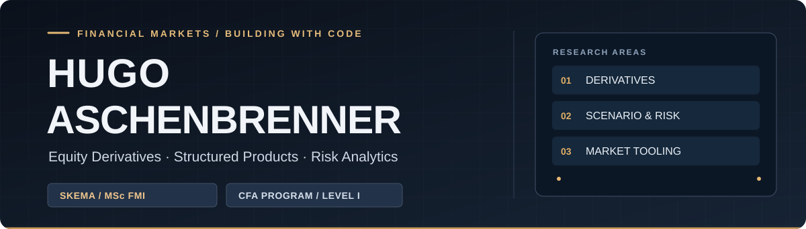
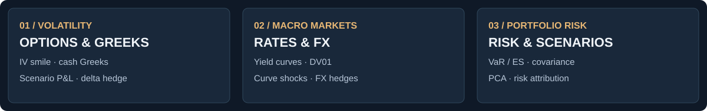

  

  
<strong>Financial Markets & Investments MSc · SKEMA Business School</strong> 
  Passed Level I of the CFA Program · Paris, France

  

    
    
    
  

## Markets-first. Code-driven.

I study **Financial Markets & Investments** at SKEMA and focus on **Equity Derivatives, Structured Products, and Sales / Sales-Trading**. I use code to make pricing, hedging, and risk concepts more transparent—turning financial models into interactive tools that explain *what changed, why, and how much*.

**2027:** Seeking a **six-month internship from May 2027** in Equity Derivatives / Structured Products Sales or Sales-Trading. Open to opportunities across Europe.

### What I work on

## Featured project — Market Analytics Terminal

**A cross-asset Sales & Trading and risk-analysis workstation.** The terminal connects market inputs, model calculations and stress scenarios with plain-language interpretation and exportable results.

  
  Equity Derivatives workspace · real screenshot from the repository · click to explore the V2 app

**Explore three workspaces:**

<table>
<tr>
<td width="33%" valign="top">
 
<strong>Equity options</strong> 
IV smile, Greek sensitivities, full repricing and hedging experiments.
</td>
<td width="33%" valign="top">
 
<strong>Rates &amp; FX</strong> 
Curve shifts, DV01 and key-rate risk, bond pricing and FX analysis.
</td>
<td width="33%" valign="top">
 
<strong>Portfolio risk</strong> 
Historical/parametric VaR, expected shortfall, PCA and risk attribution.
</td>
</tr>
</table>

**[Try the V2 terminal](https://market-analytics-terminal.streamlit.app/?version=v2)** · **[Source and technical documentation](https://github.com/HugoAschenbrenner/market-analytics-terminal)**

Financial-model boundaries: examples may rely on synthetic or dated observations. Outputs are illustrative analyses—not executable market quotes, audited investment results or regulatory risk numbers.

## Other work

**[Digital Business Card](https://github.com/HugoAschenbrenner/digital-business-card)** — A mobile-first networking application using **Next.js, TypeScript and React**. Includes vCard and QR exports, offline support, and an optional private administration workflow. A practical complement to the market-focused Python/R work.

## Toolkit

**Markets:** Equity options · structured products · fixed income · FX · portfolio risk

**Modelling:** Black–Scholes · Greeks · Monte Carlo · duration/DV01 · VaR/ES · scenario analysis

**Engineering:** Python · pandas · NumPy · SciPy · R · Streamlit · Excel/VBA · TypeScript · Next.js

---

  <strong>Interested in equity derivatives, market risk, or financial analytics?</strong>  
  <a href="https://www.linkedin.com/in/hugo-aschenbrenner-pro/">LinkedIn</a>
  &nbsp;·&nbsp;
  <a href="mailto:hugo.aschenbrenner@skema.edu">Email</a>
  &nbsp;·&nbsp;
  <a href="https://github.com/HugoAschenbrenner/market-analytics-terminal">Flagship repository</a>

